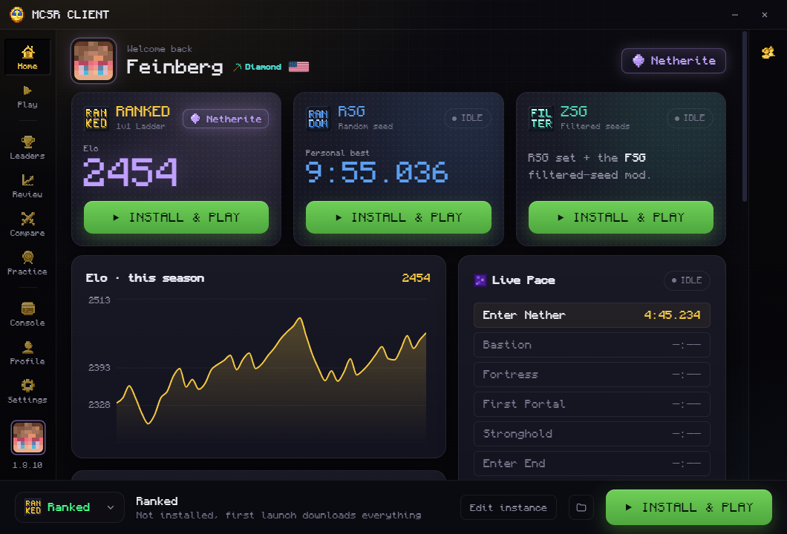

# MCSR Client

A launcher and stats client for Minecraft 1.16.1 speedrunning on Windows. It installs and runs the
Ranked, RSG and ZSG setups for you and shows your MCSR Ranked and paceman stats in the same window.

**MCSR Client follows the [Minecraft speedrunning rules](https://mc.sr/rules/).** The game is launched
by an unmodified Prism Launcher, one of the allowed launchers, and the client only installs and starts
legal setups. See [Following the rules](#following-the-rules) for how each rule is met.

**[Download the latest installer](https://github.com/xSIRDON/MCSR-Client/releases/latest)** (v2.0.0, updates itself after that)



## Following the rules

MCSR Client is built to keep your runs legal under the [Minecraft speedrunning rules](https://mc.sr/rules/):

| Rule | What the client does |
| --- | --- |
| **A.1.1** allowed launcher | The game is launched by stock Prism Launcher (A.1.1.c), unmodified and checked against its official release hash. |
| **A.8.5** legal mods | Instances are installed with the MCSR Ranked pack and the legal RSG and ZSG mod sets only. |
| **A.8.15** Hermes data | Only the paceman tracker reads it, and it is allowed by name. |
| **A.8.16** DLL injection | Only Toolscreen is injected, and it is whitelisted. |
| **A.8.18** debug flags | None are used. |
| **A.8.19** Java agents | None are used. The game runs on plain Java 21 with ZGC. |
| **A.9.1** multiple instances | Ranked, RSG and ZSG each have their own game folder. |

If you add mods yourself, such as a SeedQueue beta jar, check that they are on the
[legal mods list](https://github.com/Minecraft-Java-Edition-Speedrunning/legal-mods) before submitting a run.

## What it does

**Instances**

- Ranked: the MCSR Ranked pack, with the ranked mod pulled from Modrinth so it stays current.
- RSG: the legal mod set without the ranked mod, plus SeedQueue with a wall already set up.
- ZSG: the RSG set with FSG added.
- Downloads Minecraft, Fabric and Java on first launch, then starts the game through an unmodified
  copy of Prism Launcher running in the background. Your existing instances are used as they are.
- Runs the game on Java 21 with ZGC, since Java 8's GC pauses freeze the SeedQueue wall.
- Sizes the SeedQueue settings and RAM to your PC before launch (can be turned off per instance).
- Imports `options.txt`, `hotbar.nbt`, `config/`, resource packs and worlds from another instance.
- Exports an instance as a zip that MultiMC and Prism can import.
- Shows each instance's game logs and crash reports, with a button to upload one to mclo.gs.
- Sign in with Microsoft. Multiple accounts are supported.

**Ranked stats**

- Elo, rank, win rate, streaks, best and average time, an Elo graph and your recent matches.
  Open a match to see both players' splits side by side.
- Leaderboard and player search, with any past season or career totals.
- Review tab: each split ranked against the playerbase or against your own tier, the next tier's
  median splits next to yours, and breakdowns by seed and bastion type.
- Compare tab: two players head to head, with an estimated win chance.

**RSG**

- Starts the paceman tracker with the game and shows your live pace on the home page.
- PB from paceman's PB table, recent runs with real splits, and the split funnel.
- Ninjabrain Bot and Toolscreen are installed and started for you.

**Practice**

Pulls top-runner ranked matches from [GapCheck](https://gapcheck.gg), filtered by seed type,
bastion, finish time, rank or runner. You get all four seeds to paste into a private room, then
your splits against theirs once you've played it, with links to the runner's VOD at each split.

**Watchlist**

Star any runner and the rail on the right shows when they are in a ranked match or on pace, with a
live run timer and a link to their stream.

## Building

Needs Node 22 or newer.

```
npm install
npm run dev
```

`npm run dist` builds the Windows installer into `release/`. `npm test` runs the tests.

## Credits

Thanks to the people behind MCSR Ranked, SeedQueue, FSG, Ninjabrain Bot, paceman, Toolscreen,
Fabric and Modrinth, and to cylorun, Luxvored and marmarounos for GapCheck.

Games are started with [Prism Launcher](https://github.com/PrismLauncher/PrismLauncher) (GPL-3.0), downloaded
from its official release and checked against a pinned hash.

MIT licensed.
